Keep the files your analysis reads in `_raw_data/` and save the results it
produces in `_output/`. With those names, you can run your first build
without writing a configuration file. This example calculates a mean,
archives the input and result on GitHub, and reproduces the result in a
fresh copy of the project.

## Start with a GitHub project

Clone your GitHub repository (download a working copy with Git) and open
its folder in R or RStudio. Use a
repository where you can push commits and create releases. For a brand-new
repository, add a README on GitHub before you clone it so the release
has a commit to attach to. The input files
you archive will be available to people who can read that repository.

Install projr and its GitHub tools once in R.

```{r eval=FALSE}
install.packages(c("remotes", "gh", "httr"))
remotes::install_github("SATVILab/projr@*release")
```

If this is your first time publishing a release from R, create a
fine-grained GitHub token for this repository with read and write access
to **Contents**. Run `gitcreds::gitcreds_set()` and paste the token when
prompted. [GitHub release permissions](https://docs.github.com/en/rest/releases/releases#create-a-release)

## Give the analysis an input

Run these lines in the project folder, or put one of your own CSV files
in `_raw_data/` and adapt the script below to its column names.

```{r eval=FALSE}
dir.create("_raw_data", showWarnings = FALSE)
write.csv(data.frame(value = c(2, 4, 6)), "_raw_data/measurements.csv",
          row.names = FALSE)
```

Save the following code as `analysis.R` in the project folder.

```{r eval=FALSE}
measurements <- read.csv("_raw_data/measurements.csv")
result <- mean(measurements$value)
writeLines(as.character(result), projr::projr_path_get("output", "mean.txt"))
```

On a published build that last line writes `_output/mean.txt`. The path
helper also creates the folder and sends preview builds to a separate
location. An existing script that creates and writes directly to
`_output/` can keep doing so for production builds. Keep original
inputs in the input folder because a build can clear previous results.

## Build and archive it

Run this in the R console, from the project folder. On the first build,
projr names the checkout’s full path and asks whether it may run the
project’s scripts and hooks, write the configured files, and carry out
requested Git or archive operations. Answer yes to approve those steps
together. Later interactive builds in the same checkout reuse that approval.

```{r eval=FALSE}
library(projr)
projr_build(archive_github = TRUE)
readLines("_output/mean.txt")
# [1] "4"
```

If prompted, enter a short description of what changed. The first build
writes `_projr.yml` with the folder names it uses. It runs `analysis.R`,
records a version, and uploads the versioned files to the GitHub release
named `archive`. Later builds can share that release. The build log
connects the version to the code, and the archive records which files
belong to it.

In an unattended job, pass the checkout’s root directory as `project`.
From that root the equivalent call is
`projr_build(project = ".", archive_github = TRUE)`. This selects the
checkout for that build. The job also needs Git and GitHub credentials for
the push and upload.

## Restore the inputs and run the analysis again



Clone the repository into a new folder. To reproduce the most recent
build, open that copy as it is. For an older result, open a terminal in
the new folder and list the saved builds.

```sh
git log --oneline --grep="^Build v"
```

Find the release version and description you want, such as
`Build v0.1.0: Update measurements`. Copy the short identifier at the
start of that line and run `git checkout --detach IDENTIFIER`, replacing
`IDENTIFIER` with the one you copied. This loads the code for that build.

Open that checkout in R to restore its inputs and run a local preview.
The first interactive build asks for approval in this new checkout, too.

```{r eval=FALSE}
library(projr)
projr_restore()
projr_build_dev()
readLines(projr_path_get("output", "mean.txt", safe = TRUE))
# [1] "4"
```

`projr_restore()` downloads the raw inputs for that build and checks
their contents against the recorded file hashes. `projr_build_dev()`
then runs the analysis locally so you can inspect the result without
publishing another version.

## Keep existing folder names

If your analysis already uses `data/original/` and `results/`, you can
keep both names. Before the first build, save this as `_projr.yml` at
the project root. If a build already created the file, edit the
corresponding paths in it.

```yaml
directories:
  raw-data:
    path: data/original
  output:
    path: results
  cache:
    path: _tmp
  docs:
    path: docs
```

The labels on the left tell projr what each folder is for. Paths in the
configuration start at the project root. The cache holds temporary build
files and `docs` collects rendered reports. When you use a different input
path in the example, update `read.csv()` to match, or read from
`projr_path_get("raw-data", "measurements.csv")` so the script uses
the configured path directly.

## Skip a script

If you keep an experimental script called `scratch.R` beside `analysis.R`,
add this setting to the existing `build` section of `_projr.yml`.

```yaml
build:
  scripts:
    - exclude: scratch.R
```

With just this exclusion, projr still finds and runs `analysis.R` and any
other scripts or documents it would normally select.

See the [configuration reference](configuration.html) for all the
settings, the [build guide](build-process.html) for script execution,
and the [restore guide](restore-artifacts.html) for other ways to
recover files.
