```{r, include = FALSE}
knitr::opts_chunk$set(
  collapse = TRUE,
  comment = "#>"
)
```

Scripts and hooks customize projr's build process.
Scripts control which documents to render; hooks run custom R code before or after builds.

Both are configured in `_projr.yml` and have separate settings for production
builds (`projr_build_patch()`, etc.) and development builds (`projr_build_dev()`).

## Build Scripts

Build scripts specify which documents to render and which R scripts to run.

### Configuration format

List the files you want to run in order under `build.scripts` or
`dev.scripts` in `_projr.yml`. Paths start at the project root.

```yaml
build:
  scripts:
    - prepare.R
    - analysis.qmd
    - tables.R
    - report.qmd
    - summarize.R

dev:
  scripts:
    - quick-test.qmd
```

### Priority

Production builds use this order:

1. `build.scripts` in `_projr.yml`
2. Automatic detection

Development builds use this order:

1. `scripts` argument to `projr_build_dev()`
2. `dev.scripts` in `_projr.yml`
3. `build.scripts` in `_projr.yml`
4. Automatic detection

When `dev.scripts` is set, it completely replaces `build.scripts` for dev
builds. To include production scripts in dev builds, list them explicitly
under `dev.scripts`.

When a [named pipeline](#named-pipelines) is selected, its scripts combine
with these inline settings and with the `scripts` argument.

### Skip files

Add an `exclude:` item to skip a file or a group of files. For example,
this runs the R scripts in `analysis/` alphabetically, skips
`analysis/scratch.R`, and then renders `report.qmd`.

```yaml
build:
  scripts:
    - analysis/*.R
    - report.qmd
    - exclude: analysis/scratch.R
```

Each `exclude:` item takes one path or pattern. It applies to the whole
list wherever you place it. If the list contains only exclusions, projr
starts with automatic discovery and skips the matches. The quoted YAML
entry `"!analysis/scratch.R"` also works. For a one-off selection in R,
use a string such as `"!analysis/scratch.R"`.

### Execution order

An inclusion that matches no files causes an error before the build starts.
Use `scripts = character()` in R or `scripts: []` in YAML to skip rendering
and scripts.

With an explicit selection, scripts run in the listed order. Each glob
expands alphabetically. A file matched by overlapping globs runs once.
Listing an R script or standalone document twice runs it twice. Quarto and
Bookdown projects can render each project document only once, so projr
reports an error if you explicitly list one twice.
When a Quarto or Bookdown project has selected project documents, projr
renders those documents together at the position of the last one in the
list. In the first example, `tables.R` appears between two project documents,
so it runs before the project renders. The selected documents stay in the project's
YAML through post-build hooks, and projr restores that YAML before switching
to the development version.



With automatic detection, a project renders using its existing YAML,
followed by top-level R scripts in alphabetical order. Without a project,
top-level `.qmd`, `.Rmd`, and `.R` scripts run alphabetically. Automatic
R script discovery skips configured hooks, names starting with `_`, and
`renv_repos.R`.

To change the regular selection, edit `build.scripts` or `dev.scripts`.
For a one-off development build, pass the selection to `projr_build_dev()`.
The `projr_yml_hooks_add_*()` functions below configure pre- and post-build R code.

### Example: separate dev and production scripts

```yaml
# _projr.yml
build:
  scripts:
    - full-analysis.qmd
    - supplementary.qmd
    - appendix.qmd

dev:
  scripts:
    - quick-test.qmd
```

```{r eval=FALSE}
projr_build_dev()   # renders quick-test.qmd only
projr_build_patch() # renders all three documents
```

### Example: one-off builds

```{r eval=FALSE}
projr_build_dev(scripts = "exploratory-analysis.Rmd")
projr_build_dev(scripts = c("reports/*.Rmd", "!reports/draft.Rmd"))
```

## Build Hooks

Hooks run custom R scripts at specific points in the build process.

### Configuration format

Hooks are plain character vectors organized by stage. Three stage keys are
available: `pre` (before the build), `post` (after the build), and `both`
(runs at both stages). File paths are relative to the project root.

```yaml
build:
  hooks:
    pre:
      - hooks/setup.R
      - hooks/download-data.R
    post:
      - hooks/cleanup.R
    both:
      - hooks/log-timestamp.R

dev:
  hooks:
    pre: hooks/dev-setup.R
```

`build.hooks` are ignored in dev builds. `dev.hooks` are ignored in
production builds. Unlike scripts, there is no fallback between them.

### Execution details

Hooks within a stage run in the order listed. Each hook runs in an isolated
child environment of the global environment, so objects created in one hook
are not available in subsequent hooks. To share data between hooks, save to
disk (e.g., `saveRDS()`).

Where hooks run in the build flow:

```
Production build:
  1. Pre-build hooks
  2. Version bump
  3. Clear output directories
  4. Git commit (if configured)
  5. Render scripts
  6. Git commit outputs (if configured)
  7. Distribute to remotes
  8. Post-build hooks

Development build:
  1. Dev pre-build hooks
  2. Clear output directories
  3. Render scripts
  4. Dev post-build hooks
```

Like scripts, all hook files are validated before the build starts.
A missing hook file causes an immediate error. If a hook fails at runtime,
the build stops.

### Managing hooks with R

```{r eval=FALSE}
projr_yml_hooks_add(path = "hooks/setup.R", stage = "pre")
projr_yml_hooks_add_pre("hooks/check-auth.R")
projr_yml_hooks_add_post("hooks/cleanup.R")

# Append instead of overwriting
projr_yml_hooks_add("hooks/extra.R", stage = "pre", overwrite = FALSE)

# Remove all hooks
projr_yml_hooks_rm_all()
```

### Example: data preparation hook

```{r eval=FALSE}
# hooks/prepare-data.R
data_url <- Sys.getenv("DATA_URL")
if (!nzchar(data_url)) stop("DATA_URL not set")

download.file(data_url, destfile = "_raw_data/data.csv")
data <- read.csv("_raw_data/data.csv")
stopifnot(nrow(data) > 0)
message("Data preparation complete")
```

```yaml
build:
  hooks:
    pre: hooks/prepare-data.R
```

### Example: separate dev and production hooks

```yaml
build:
  hooks:
    pre: hooks/prod-setup.R

dev:
  hooks:
    pre: hooks/dev-setup.R
```

```{r eval=FALSE}
# hooks/dev-setup.R
message("Setting up dev environment...")
Sys.setenv(PROJR_OUTPUT_LEVEL = "debug")
```

```{r eval=FALSE}
# hooks/prod-setup.R
message("Setting up production environment...")
source("hooks/check-auth.R")
source("hooks/prepare-data.R")
```

## Named pipelines

A pipeline names an ordered set of scripts and hooks. Define pipelines under
the top-level `pipelines` key, then select them with `build.pipeline` for
production builds and `dev.pipeline` for development builds.

```yaml
pipelines:
  primary:
    scripts:
      - prepare.R
      - analyse.R
      - report.qmd
    hooks:
      pre: hooks/check-inputs.R
      post: hooks/validate-results.R
  sensitivity:
    scripts: [sensitivity.R, sensitivity.qmd]

build:
  pipeline: primary

dev:
  pipeline: primary
```

A pipeline's `scripts` accept the same entries as `build.scripts`: paths,
glob patterns, `- exclude:` items and quoted `"!path"` exclusions. Its
`hooks` accept `pre`, `post` and `both`. Rendering, project handling and
hook execution work as described above. Pipeline names cannot contain `:`
or `,`.

Development builds use `dev.pipeline`. Without it, they use
`build.pipeline`. Remote sources and destinations, versioning, renv, Git and
publication stay under `build`. A pipeline only chooses scripts and hooks.

### Selecting several pipelines

`pipeline` takes one name or a list. Entries can be glob patterns.

```yaml
pipelines:
  prepare:
    scripts: [prepare.R]
  model-linear:
    scripts: [model-linear.R]
  model-mixed:
    scripts: [model-mixed.R]
  report:
    scripts: [report.qmd]

build:
  pipeline: [prepare, model-*, report]
```

This runs `prepare.R`, `model-linear.R`, `model-mixed.R` and then renders
`report.qmd`. The entries run in the order given. A glob's matches run in
their order under `pipelines`. A pipeline matched more than once runs once,
at its first position. Each phase's hooks combine in the same order, and a
hook named more than once runs once, at its first position. A name or glob
that matches no pipeline stops the build before any hook, script or file
change.

### Switching pipelines for one build

Pass `pipeline` to `projr_build()`, `projr_build_patch()`,
`projr_build_minor()`, `projr_build_major()` or `projr_build_dev()` to
replace the configured selection for that build. The argument also accepts
several names or globs.

```{r eval=FALSE}
projr_build_patch()                          # runs primary
projr_build_patch(pipeline = "sensitivity")  # runs the sensitivity analysis
projr_build_dev(pipeline = c("primary", "sensitivity"))
```

The console reports the selected pipelines and their scripts, and the
detailed log records their hooks. A production build adds a **Pipeline**
section to `.projr/BUILDLOG.md` with the names, scripts and hooks.

### Adding inline scripts and hooks

`scripts` and `hooks` under `build` (or `dev`) combine with the selected
pipelines. Use them for work that should run whichever pipeline is selected.

```yaml
pipelines:
  analysis:
    scripts: [prepare.R, analyse.R]
    hooks:
      pre: hooks/check-data.R
      post: hooks/validate-results.R

build:
  scripts: initialise.R
  pipeline: analysis
  hooks:
    pre: hooks/check-build.R
    post: hooks/finish-build.R
```

A production build runs:

1. Pre-build hooks: `hooks/check-data.R`, then `hooks/check-build.R`.
2. Scripts: `initialise.R`, `prepare.R`, `analyse.R`.
3. Post-build hooks: `hooks/validate-results.R`, then `hooks/finish-build.R`.

`scripts` appears before `pipeline`, so `initialise.R` runs first. `hooks`
appears after `pipeline`, so the inline hooks run after the pipeline's hooks
in each phase. Moving `hooks` above `pipeline` would run
`hooks/check-build.R` before `hooks/check-data.R`, and
`hooks/finish-build.R` before `hooks/validate-results.R`. With several
pipelines, the inline entries go before or after the whole group.

A pre-build hook stays in the pre-build phase and a post-build hook stays in
the post-build phase, whatever the key order. A `both` hook runs in each
phase. A hook listed both inline and in a pipeline runs once.

An explicit empty inline list, such as `scripts: []`, adds nothing and leaves
the pipelines' scripts in place. Without a selected pipeline, `scripts: []`
still skips rendering and scripts.

Development builds keep their usual inline sources. They combine the
pipelines with `dev.scripts` (or `build.scripts` when `dev.scripts` is
absent) and with `dev.hooks`. They never use `build.hooks`. The `scripts`
argument of `projr_build_dev()` takes the place of those inline scripts and
combines with the pipelines in the same position. Without a pipeline it
replaces `dev.scripts` and `build.scripts`, as before.

### Turning pipelines off

Set `pipeline: false` or `pipeline: []` to select no pipeline. In
`_projr-local.yml` or a profile, this overrides the `pipeline` set in a
lower-precedence file, because the higher file's value replaces the lower
one whole. For one build, pass `pipeline = FALSE`. Inline scripts and hooks,
and the `scripts` argument, still run. To run a single script during
development:

```{r eval=FALSE}
projr_build_dev(scripts = "explore.R", pipeline = FALSE)
```

### How projr reads key order

YAML mappings are formally unordered. Reading key order here is a projr
convention, not a YAML guarantee, so keep `scripts`, `pipeline` and `hooks`
in the same mapping and in the order you want.

projr reads the order from the file with the highest precedence that sets
`pipeline`: `_projr-local.yml`, then the active profiles in order, then
`_projr.yml`. For a development build it looks for `dev.pipeline` first, then
`build.pipeline`. If that mapping does not contain the inline key, the inline
entries run first.

When only the `pipeline` argument selects pipelines and no file sets
`pipeline`, the pipelines' entries run after the inline entries. When the
argument replaces a configured selection, the configured position still
applies.

A profile's `pipelines.<name>.scripts` replaces the list from `_projr.yml`
rather than adding to it.

## Tips

- Use relative paths for portability.
- Keep each hook focused on one task. Use descriptive filenames
  (e.g., `validate-credentials.R` rather than `hook1.R`).
- Wrap external operations in `tryCatch()` so error messages are actionable.
- Test hooks outside a build with `source("hooks/my-hook.R")`.

## See Also

- `?projr_yml_hooks_add` - Add hooks programmatically
- `vignette("configuration")` for the script selection and rendering reference.
- `?projr_build_dev` - Development builds
- `?projr_build_patch` - Production builds
